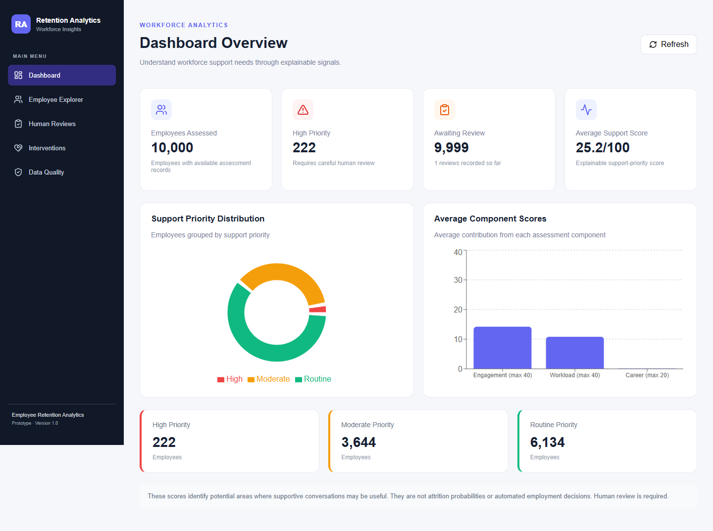
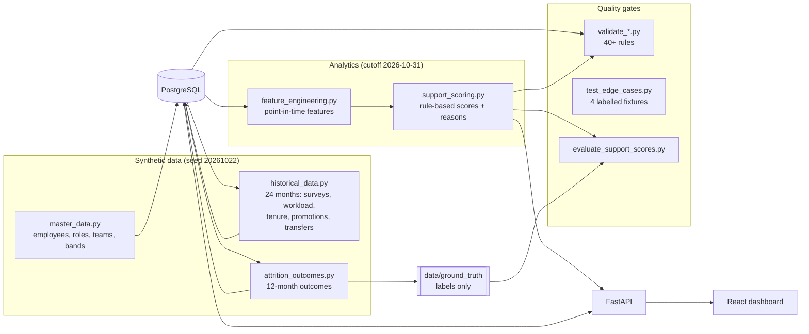
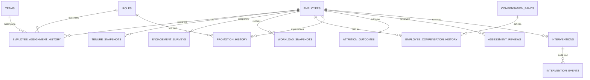
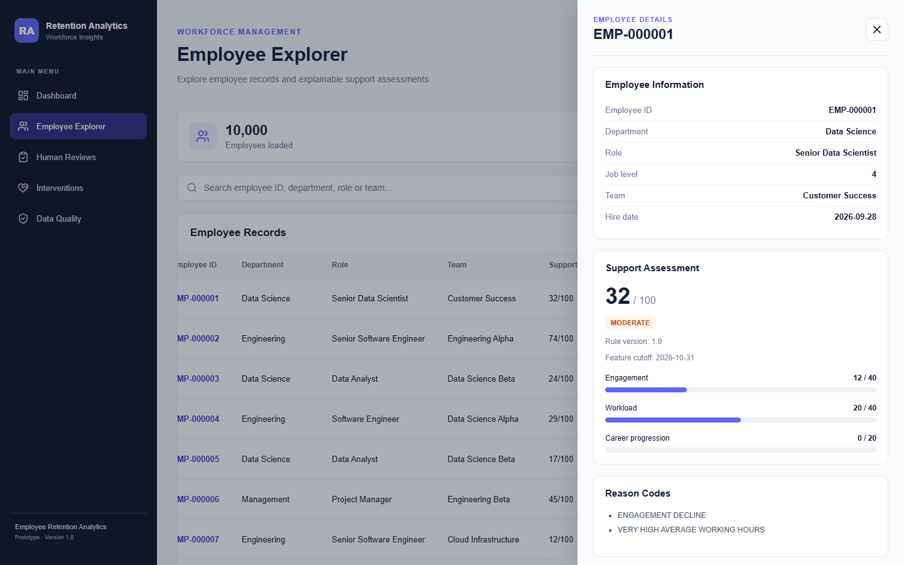
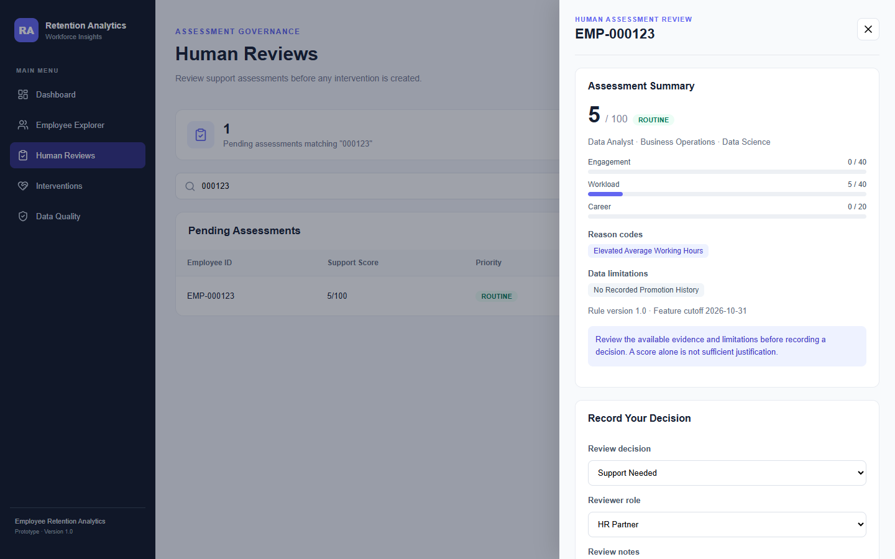
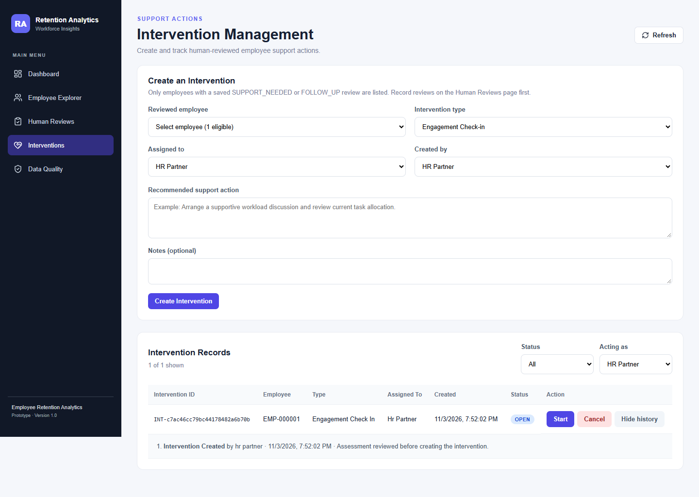
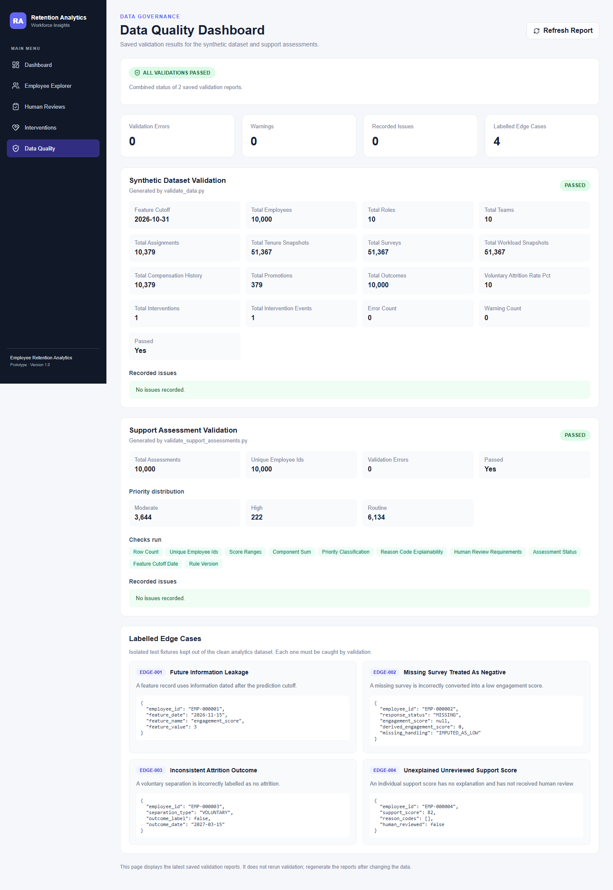

# Yotta Employee Retention Analytics

An explainable employee-support system built on a reproducible synthetic
dataset of **10,000 employees with 24 months of history**. It turns
point-in-time workforce signals into transparent support-priority scores,
requires a **human review before any intervention** can be created, and
tracks every intervention through an auditable lifecycle.

> **These scores are not attrition predictions or employment decisions.**
> They flag where a supportive conversation may help. Every assessment
> requires human review, and the reviewer can decide that no action is
> needed.



---

## Contents

1. [Business problem](#business-problem)
2. [Architecture](#architecture)
3. [Technology stack](#technology-stack)
4. [Database schema](#database-schema)
5. [Quick start](#quick-start)
6. [Generating the 10,000-employee dataset](#generating-the-10000-employee-dataset)
7. [Running the backend and frontend](#running-the-backend-and-frontend)
8. [Dashboard screenshots](#dashboard-screenshots)
9. [Data validation results](#data-validation-results)
10. [Evaluation metrics](#evaluation-metrics)
11. [The four edge cases](#the-four-edge-cases)
12. [How the system was verified](#how-the-system-was-verified)
13. [Reproducibility](#reproducibility)
14. [Assumptions, limitations and next steps](#assumptions-limitations-and-next-steps)
15. [AI use and prompt history](#ai-use-and-prompt-history)

---

## Business problem

Voluntary attrition is expensive, and early, supportive conversations
about workload, engagement or career growth can help. Opaque "flight risk"
scores create their own problems, though: they can be unfair, they can
leak future information, and they invite automated decisions about
people.

This project explores a safer design:

- **Explainable scores.** Every point in a score comes from a named rule
  with a reason code (for example `VERY_HIGH_CAPACITY_UTILIZATION`).
- **No future leakage.** Features use only data on or before the cutoff
  (2026-10-31). Outcome labels for the following 12 months are stored
  separately and read only by the evaluation step.
- **Missing data is not negative evidence.** A skipped survey is neutral,
  not a low score.
- **Human in the loop.** The API refuses to create an intervention unless
  a reviewer has recorded `SUPPORT_NEEDED` or `FOLLOW_UP`.

## Architecture



The generator, analytics and evaluation are separate modules. Feature
engineering never queries `attrition_outcomes`; only the evaluation step
reads ground truth. See [docs/architecture.md](docs/architecture.md) for
the components and API reference.

## Technology stack

| Layer | Technology |
|---|---|
| Database | PostgreSQL 16 (Docker) |
| Backend | Python 3.12, FastAPI, SQLAlchemy 2, Pydantic |
| Data generation and analytics | Standard-library Python (`random` with a fixed seed, `csv`, `statistics`) |
| Frontend | React 19, Vite, React Router, Recharts, Axios, lucide-react |
| Verification | Validation scripts, FastAPI TestClient, Playwright (UI walkthrough) |

The backend has only six runtime dependencies (`backend/requirements.txt`).

## Database schema

The schema has 14 tables (the 10 required entities plus assignment
history, compensation history, intervention events and assessment
reviews). Histories are stored as dated records and never overwritten.



Constraints enforce the business rules in the database itself. For
example: a `MISSING` survey must have a `NULL` score; a `VOLUNTARY`
outcome must have `outcome_label = TRUE` and a date; and only one review
is allowed per employee per rule version. Column-level detail is in
[docs/data_dictionary.md](docs/data_dictionary.md).

## Quick start

**Prerequisites:** Docker Desktop, Python 3.12, Node.js 20+.

```powershell
git clone <this-repo-url> yotta-employee-retention-analytics
cd yotta-employee-retention-analytics

# 1. Configuration (local defaults; never commit .env)
copy .env.example .env                       # macOS/Linux: cp .env.example .env
copy frontend\.env.example frontend\.env

# 2. Database
docker compose up -d db

# 3. Backend environment
cd backend
python -m venv venv
.\venv\Scripts\Activate.ps1                  # macOS/Linux: source venv/bin/activate
pip install -r requirements.txt
cd ..

# 4. Generate, validate and evaluate all data (about 4 minutes)
python scripts/run_pipeline.py

# 5. Check the API end to end (leaves the database unchanged)
python scripts/verify_api.py
```

Then start the app as described below.

## Generating the 10,000-employee dataset

`scripts/run_pipeline.py` runs every step in order and stops at the
first failure:

| # | Step | Output |
|---|---|---|
| 1 | `create_tables.py` | 14 tables |
| 2 | `app.generator.master_data` | 10,000 employees, 10 roles, 10 teams, 10 bands |
| 3 | `app.generator.historical_data` | 51,367 surveys / workload / tenure snapshots, 379 promotions and transfers |
| 4 | `app.generator.attrition_outcomes` | 12-month outcomes plus `data/ground_truth/` |
| 5 | `validate_data.py` | `data/processed/validation_report.json` |
| 6 | `app.analytics.feature_engineering` | `employee_features.csv` (30 point-in-time features) |
| 7 | `validate_features.py` | Feature checks |
| 8 | `app.analytics.support_scoring` | `support_assessments.csv` |
| 9 | `validate_support_assessments.py` | `support_validation_report.json` |
| 10 | `test_edge_cases.py` | Edge-case detection report |
| 11 | `evaluate_support_scores.py` | `evaluation_report.json` |

The employee count is set by `TOTAL_EMPLOYEES` in
`backend/app/generator/master_data.py` (set it to 100 for a quick trial),
and the seed by `SEED = 20261022` in each generator.

The generators refuse to write into a database that already holds data.
To regenerate from scratch, run `docker compose down -v`, then
`docker compose up -d db`, then the pipeline again.

**Committed data.** The large generated CSVs are not committed because
they can be regenerated. The repository includes:

- `data/sample/`: the first 100 rows of features, assessments and ground
  truth, for a quick look without running anything;
- `data/ground_truth/attrition_ground_truth.csv`: all labels, kept apart
  from model inputs;
- `data/processed/*report*.json` and `*_issues.csv`: validation and
  evaluation reports;
- `data/edge_cases/edge_case_catalog.json`: the four labelled fixtures.

## Running the backend and frontend

Use two terminals, with the database running and the pipeline already
completed.

```powershell
# Terminal 1: API on http://127.0.0.1:8000 (interactive docs at /docs)
cd backend
.\venv\Scripts\Activate.ps1
uvicorn app.main:app --reload

# Terminal 2: dashboard on http://localhost:5173
cd frontend
npm install
npm run dev
```

| Page | What it does |
|---|---|
| Dashboard | KPIs, priority distribution, average component scores |
| Employee Explorer | Search and filter all 10,000 employees; per-employee score breakdown, reason codes and data limitations |
| Human Reviews | Queue of unreviewed assessments (highest score first) and the evidence panel; record `SUPPORT_NEEDED`, `FOLLOW_UP` or `NO_ACTION` |
| Interventions | Create interventions for reviewed employees only; move them OPEN → IN_PROGRESS → COMPLETED / CANCELLED; view the event history |
| Data Quality | Both validation reports, the checks run, and the four edge cases |

## Dashboard screenshots

| Employee Explorer | Human Review |
|---|---|
|  |  |

| Interventions | Data Quality |
|---|---|
|  |  |

## Data validation results

All validation passes on the generated dataset (`seed 20261022`).

| Check | Result |
|---|---|
| Dataset validation (`validate_data.py`): foreign keys, date order, overlapping histories, tenure arithmetic, survey rules, workload ranges, outcome consistency, leakage dates, attrition-rate range | **0 errors, 0 warnings** |
| Feature validation (`validate_features.py`): 10,000 records, 30 columns | **Passed** |
| Assessment validation (`validate_support_assessments.py`): 10 checks covering score ranges, component sums, priority bands, a reason code for every point, review flags, cutoff and rule version | **0 errors** |
| Edge-case detection (`test_edge_cases.py`) | **4 / 4 detected** |

| Dataset fact | Value |
|---|---|
| Employees | 10,000 |
| History window | 2024-11-01 to 2026-10-31 (24 months) |
| Engagement surveys / workload snapshots / tenure snapshots | 51,367 each |
| Internal moves (assignment history beyond hire) | 379 |
| Voluntary attrition (next 12 months) | 1,000 (10.0%) |
| Involuntary attrition | 400 (4.0%; labelled as not voluntary) |
| Priority split | HIGH 222 · MODERATE 3,644 · ROUTINE 6,134 |

## Evaluation metrics

`evaluate_support_scores.py` compares scores with the held-out 12-month
voluntary-attrition labels (`data/processed/evaluation_report.json`):

| Metric | Value |
|---|---|
| Base rate (voluntary leavers) | 10.0% |
| ROC AUC of support score | **0.549** |
| Voluntary attrition in HIGH / MODERATE / ROUTINE | 14.4% / 11.4% / 9.0% |
| Lift of HIGH over base rate | 1.44× |
| Flag HIGH: precision / recall | 14.4% / 3.2% |
| Flag HIGH + MODERATE: precision / recall | 11.6% / 44.7% |
| Leavers captured in the top 10% of scores | 13.3% |

**What this means:**

- The ordering is correct: higher priority bands have higher attrition.
- The signal is weak (AUC 0.55). This is expected for two reasons. The
  generator draws leavers with only a mild weighting on engagement and
  workload. And the rules were written from domain reasoning, then
  deliberately left untuned against the labels, because tuning on ground
  truth would leak the answers into the scoring.
- Because the labels are synthetic and were generated from similar
  signals, these numbers show that the pipeline recovers the planted
  pattern without leakage. They say nothing about accuracy on real
  employees.

## The four edge cases

`data/edge_cases/edge_case_catalog.json` holds four labelled records that
are deliberately wrong. They are kept out of the clean dataset, and
`test_edge_cases.py` must detect every one. The same rules are enforced
on the real data by validation (`LEAK00x`, `SURV004`, `OUT001`) and by
database constraints.

| ID | Problem | Why it matters | How it is caught |
|---|---|---|---|
| EDGE-001 | **Future information leakage**: a feature dated 2026-11-15, after the 2026-10-31 cutoff | Scores would use information unavailable at decision time | Every feature date is compared with the cutoff (`LEAKAGE001`); feature engineering filters `<= cutoff` |
| EDGE-002 | **Missing survey treated as negative**: a `MISSING` response imputed as engagement 0 | Penalises people for not answering a survey | Missing responses must stay `NULL` (`SURVEY001`); scoring gives them 0 points and adds the `NO_COMPLETED_ENGAGEMENT_SURVEY` limitation |
| EDGE-003 | **Inconsistent outcome label**: a `VOLUNTARY` separation labelled `false` | Corrupts evaluation metrics | Outcome type and label must agree (`OUTCOME001`); a database check constraint enforces it |
| EDGE-004 | **Unexplained, unreviewed score**: a score of 82 with no reason codes and no review | Opaque scores driving action about people | Every point needs a reason code (`SUPPORT001`); the API blocks interventions without a saved human review |

## How the system was verified

No hosted demo or test suite is required; this is how each part was
checked:

| Area | Method | Result |
|---|---|---|
| Data integrity | `validate_data.py`, `validate_features.py`, `validate_support_assessments.py` | All pass |
| Edge cases | `test_edge_cases.py` | 4 / 4 detected |
| API and human-review gate | `scripts/verify_api.py`: 20 checks against real PostgreSQL inside a rolled-back transaction, covering the 409 without a review, the 400 for `NO_ACTION`, duplicate-review rejection, status transitions and event history | 20 / 20 |
| Frontend | Browser walkthrough of all five pages in Microsoft Edge with Playwright: KPIs, charts, search, detail panels, review form, intervention history, phone-width layout, console errors, failed requests | 18 / 18; no console errors |
| Reproducibility | Full pipeline on an empty database, outputs compared byte for byte | Identical (see below) |
| Dependencies | `requirements.txt` installed into a new virtual environment, then the checks re-run | Pass |

## Reproducibility

- Every generator uses its own `random.Random(20261022)`, and record
  timestamps are fixed. No wall-clock values enter the data.
- **Verified:** the pipeline was run on a new, empty database, and every
  generated file (ground truth, features, assessments, evaluation report)
  was **byte-for-byte identical** to the original run. The only
  difference was the intervention count in `validation_report.json`,
  which reflects interventions created through the app, not generated
  data.
- The rule version (`1.0`) and feature cutoff are recorded on every
  assessment and every review, so a review always refers to the exact
  scoring logic it saw.

## Assumptions, limitations and next steps

**Assumptions**

- "Attrition" in evaluation means **voluntary** exit within 12 months
  after the cutoff. Involuntary exits are labelled `false`, because
  support cannot prevent them.
- The thresholds (score ≥ 60 for HIGH, ≥ 30 for MODERATE) and rule
  points are reasoned defaults, not fitted values.
- Reviewer roles (`HR_PARTNER`, `MANAGER`, `PEOPLE_PARTNER`) are
  declared in each request; the prototype has no authentication.

**Known limitations**

- The **career component** averages 0.1 out of 20. Only 379 employees
  have a promotion, and the rule deliberately treats "no recorded
  promotion" as missing evidence, not as a risk signal. The component
  works, but this dataset rarely triggers it.
- The evaluation signal is weak (AUC 0.55); see
  [Evaluation metrics](#evaluation-metrics).
- Assessments are produced by a batch job (CSV) and read by the API. They
  are not stored in a database table, so re-scoring means re-running the
  pipeline and restarting the API.
- A saved review cannot be edited. A mistaken `NO_ACTION` blocks
  interventions until the rule version changes.
- No authentication or role-based access control.
- The Employee Explorer loads all 10,000 rows into the browser (about
  4 s) and renders 200 at a time; server-side search would scale better.

**Next steps**

1. Store assessments and rule versions in PostgreSQL, with a re-scoring
   job.
2. Add authentication and per-role permissions for reviews and
   interventions.
3. Allow review amendments with a full audit trail.
4. Calibrate rule thresholds on a separate validation period, keeping
   the final period untouched.
5. Turn the verification scripts into a pytest suite in CI.

**Deviations from the original plan**

- A dedicated `assessment_reviews` table was added. Review confirmation
  now comes from a saved database record, not from a request-body
  boolean.
- The dashboard and review queue use server-side summary endpoints
  instead of downloading every record into the browser.
- Data generation uses Python's standard library instead of
  pandas/NumPy/Faker, which keeps the dependencies small.

## AI use and prompt history

AI tools were used throughout, as the challenge rules allow: a chat
assistant for stage-by-stage planning and code drafts, and Claude Code
for integration, debugging, testing and repository preparation. Every
change was run and checked locally (see
[How the system was verified](#how-the-system-was-verified)). All prompts
are in [`prompt_history/`](prompt_history/), which also explains how each
tool was used.

## Repository structure

```text
backend/
  app/
    generator/     synthetic data (master, history, outcomes)
    analytics/     point-in-time features and support scoring
    validation/    database validation rules
    api/           FastAPI routers
    schemas/       request models
    services/      assessment loading
    models.py      SQLAlchemy schema (14 tables)
  validate_*.py, test_edge_cases.py, evaluate_support_scores.py
frontend/          React + Vite dashboard
data/
  sample/          100-row samples for quick inspection
  ground_truth/    outcome labels (evaluation only)
  edge_cases/      four labelled fixtures
  processed/       validation and evaluation reports
docs/              architecture, data dictionary, methodology, screenshots
scripts/           run_pipeline.py, verify_api.py
prompt_history/    all prompts submitted to AI tools
```
